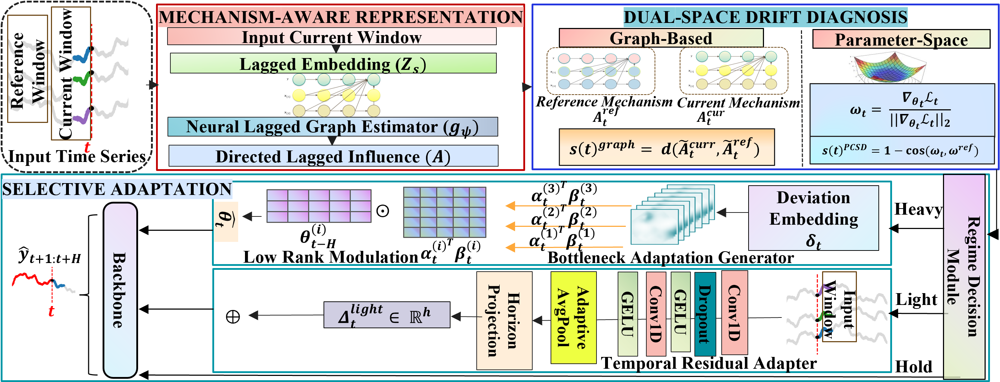

# MechAdapt

We propose *MechAdapt*, a selective online adaptation framework for multivariate time series forecasting under heterogeneous distribution shifts. The framework consists of three main components:

- Mechanism-Aware System Representation
- Dual-Space Drift Diagnosis
- Selective Adaptation Mechanism


### Supported Methods
- **MechAdapt**: Mechanism-aware selective adaptation with drift gating (this work).
- **PROCEED**: Proactive Model Adaptation
- **SOLID**: Sample-level Contextualised Adapter
- **OneNet**: Online Ensembling Network
-  **Naive**: Online using stochastic gradient descend
- **Offline**: No online adaptation.


## Usage
### Scripts

### 1. Install Requirements

```bash
conda create -n mechadapt python=3.10
conda activate mechadapt
pip install -r requirements.txt
```

### 2. Pretrain Models

```bash
bash -x scripts/pretrain/iTransformer/synthetic1.sh
```

### 3. Online Adaptation

```bash
bash -x scripts/online/iTransformer/MechAdapt/synthetic1.sh
```
### Arguments
Basic arguments:
- `--model` decides the forecast backbone.
- `--seq_len` decides the lookback length.
- `--pred_len` decides the forecast horizon.
- `--online_method` decides the online adaptation method.
- `--dataset` decides the dataset of which the file path is configured in `settings.py`.
> By default, the argument `--border_type` is set to `online` for a data split of 20:5:75 for training/validation/test.


## Citation
If you find this repository useful, please cite the corresponding paper.